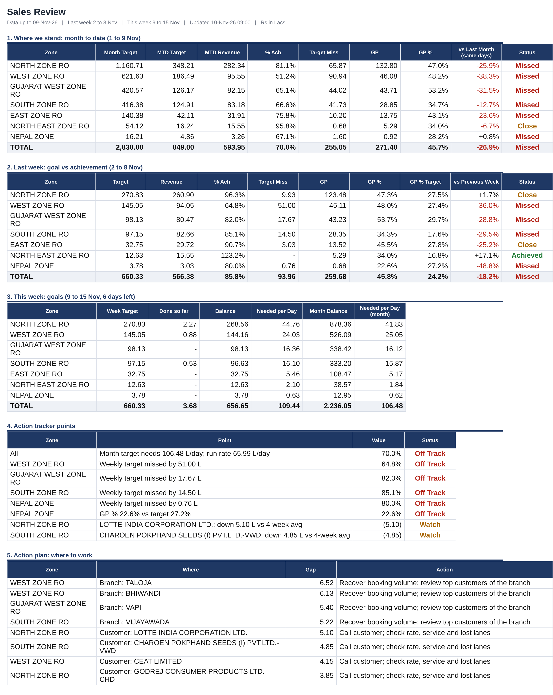

# Concised Analysis

Sales review in the **Sales Tracker** Google Sheet, filled from the GR P&L dashboard data and updated every hour.

Code: [`gr-pnl-engine/ConcisedAnalysis.gs`](../gr-pnl-engine/ConcisedAnalysis.gs) (runs inside the GR PNL Engine).

## Tabs

| Tab | Content |
|---|---|
| Concised Analysis | Five blocks, rebuilt on every update. Do not type here. |
| Targets | Monthly revenue target and GP % target per zone. The only inputs. |

## Blocks

| # | Block | Columns |
|---|---|---|
| 1 | Where we stand: month to date | Zone, Month Target, MTD Target, MTD Revenue, % Ach, Target Miss, GP, GP %, vs Last Month (same days), Status |
| 2 | Last week: goal vs achievement | Zone, Target, Revenue, % Ach, Target Miss, GP, GP %, GP % Target, vs Previous Week, Status |
| 3 | This week: goals | Zone, Week Target, Done so far, Balance, Needed per Day, Month Balance, Needed per Day (month) |
| 4 | Action tracker points | Zone, Point, Value, Status |
| 5 | Action plan: where to work | Zone, Where (branch or customer), Gap, Action |

## Definitions

| Item | Rule |
|---|---|
| Revenue | TOTAL FREIGHT |
| GP | TOTAL FREIGHT - TOTAL EXPENSE |
| Zone | BOOKING ZONE |
| Amounts | Rs Lacs |
| Week | Monday to Sunday |
| MTD | 1st of the month to the last day with data |
| Period target | Monthly target / days in month x days in the period |
| % Ach | Revenue / target for the same period |
| Target Miss | Target - Revenue (0 when achieved) |
| Status | Achieved >= 100%, Close >= 90%, Missed below 90% |
| Blank zone revenue target | TOTAL target split by each zone's revenue share of the last 3 full months |
| Blank GP % target | Zone's own GP % of the last 3 full months |
| Customer | CONSIGNOR |

### Action tracker points (auto)
- Month pace: needed per day vs run rate, when the month is behind target.
- Zones that missed last week's target (below 90%).
- Zones whose GP % last week is more than 1 point below target.
- Top 3 customers whose last-week revenue fell most against their 4-week average.

### Action plan (auto, largest gap first, 8 rows)
- Branches in Missed or Close zones with the largest drop against their 4-week average.
- Customers with the largest drop against their 4-week average.
- Customers under 10% GP % (gap = GP at target - actual GP).

Customers and branches under Rs 2 Lacs in the 4-week window are left out. All limits are in `CA_` at the top of the code.

## Setup (once)
1. The Google account that owns the GR PNL Engine needs **Editor** access to the Sales Tracker sheet.
2. Merge the PR. The `GR engine: sync` action sends the code to the engine.
3. Engine sheet > **GR PNL Engine > Concised Analysis > Turn on hourly update** (allow permissions).
4. Fill the **Targets** tab in Sales Tracker (blue cells). TOTAL defaults to Rs 2,830 Lacs a month (85 cr for Q3).

An hourly run is skipped when neither the engine data nor the date has changed. **Update now** rebuilds at once.
